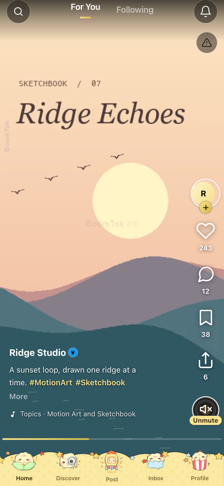
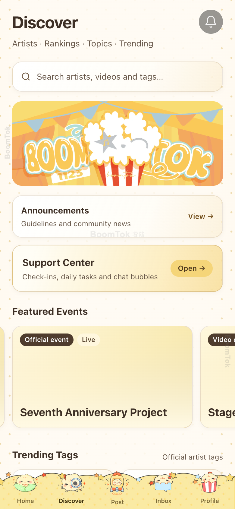
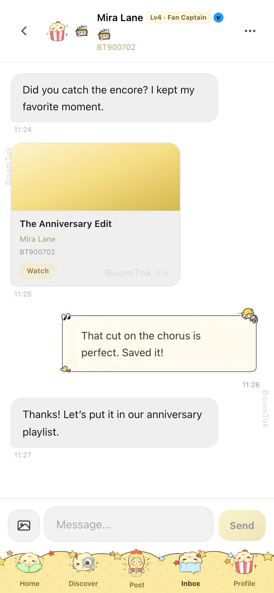
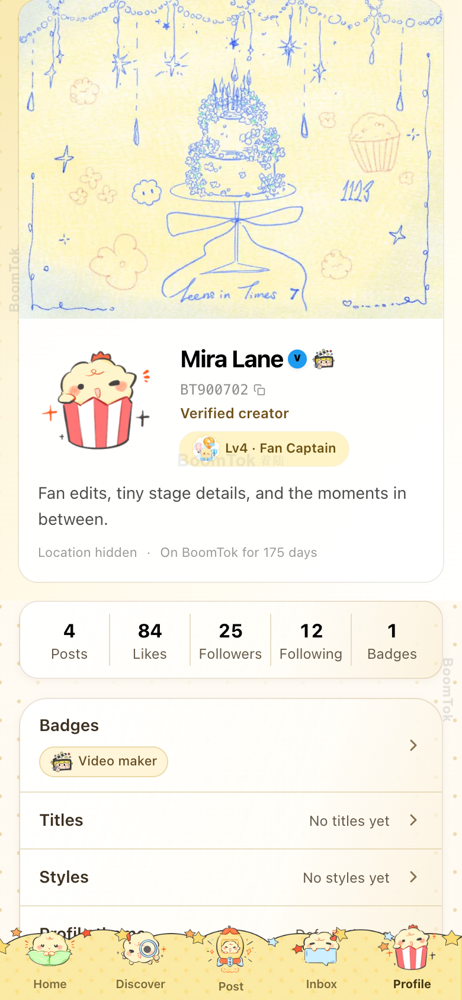
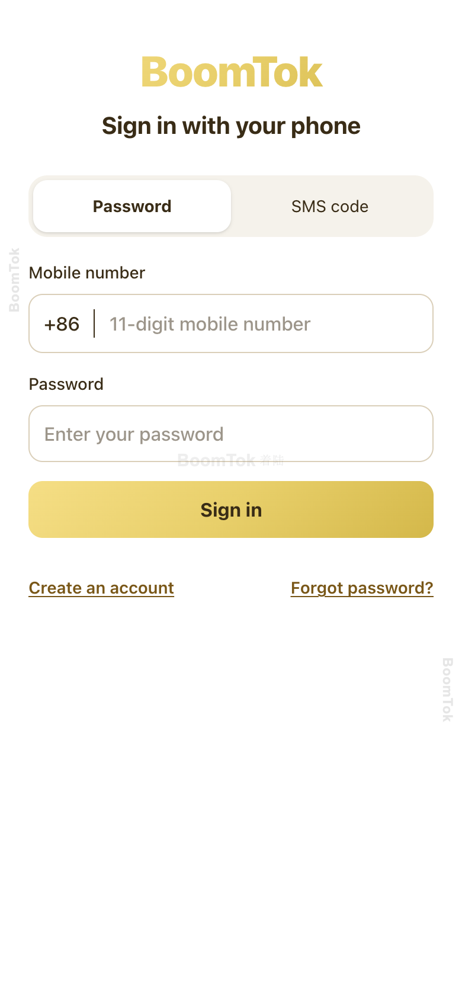
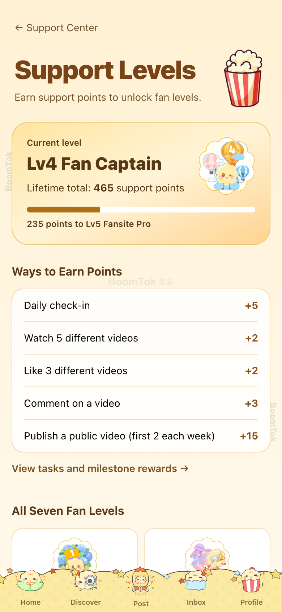
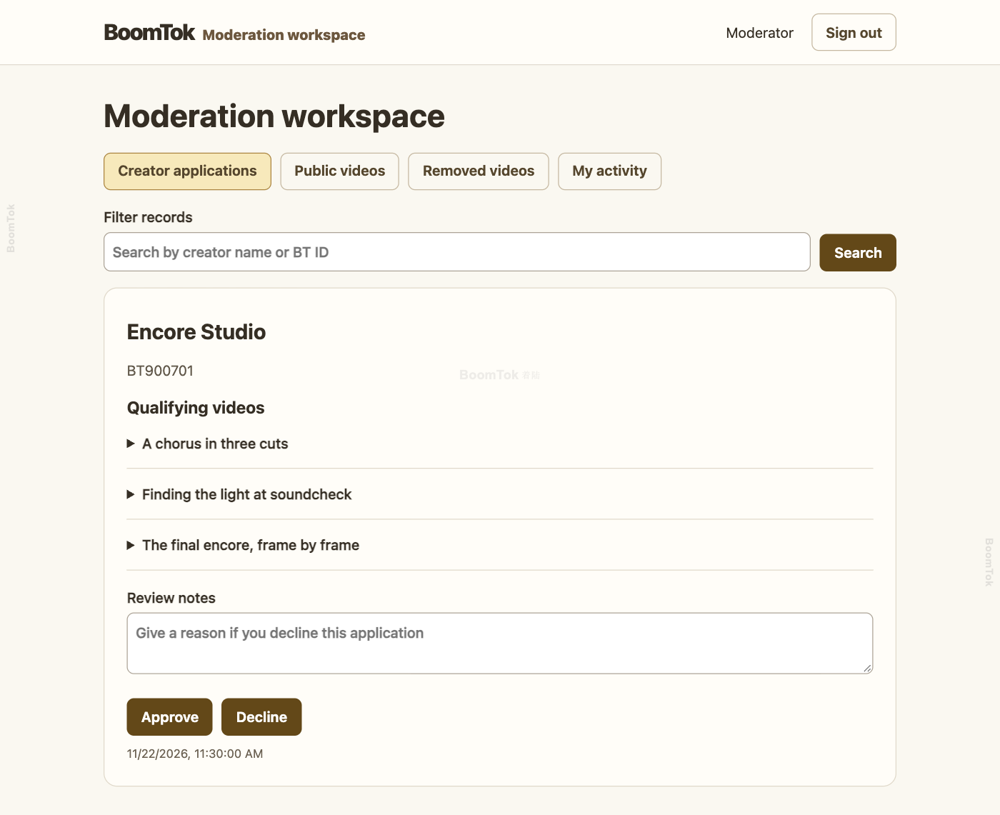
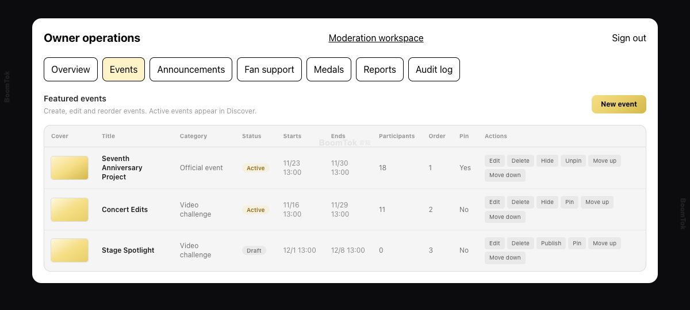
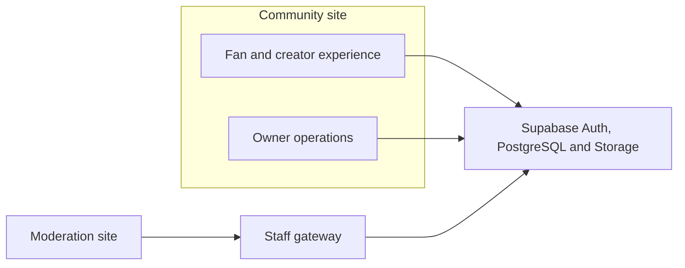

# BoomTok

BoomTok is a mobile-first short-video community for music fans. A fan can post a concert edit, share it in a private chat, and take part in an anniversary project. Creators can apply for verification, while volunteers moderate content in a separate web app.

[Open BoomTok](https://boomtok.netlify.app/)

**Active beta · May 2026 – present**

**My role** · Full-stack developer on a team of about five

## Product walkthrough

The screenshots show the original interface translated into English for readability.

### The fan community

<table>
  <tr>
    <td valign="top" width="50%">
      <strong>Video feed</strong>
      
Swipe between clips, tap the record in the lower-right corner to turn on sound, or open the creator’s profile.

      
    </td>
    <td valign="top" width="50%">
      <strong>Discovery and fan events</strong>
      
Find artists and topics, or open a featured event like the Seventh Anniversary Project to contribute a video.

      
    </td>
  </tr>
  <tr>
    <td valign="top" width="50%">
      <strong>Private messages</strong>
      
Send a clip as a playable video card. An equipped chat style decorates your own outgoing text bubbles. Shared videos keep their standard card.

      
    </td>
    <td valign="top" width="50%">
      <strong>Creator profiles</strong>
      
After publishing three distinct eligible public videos, a member can apply for the blue creator badge. A reviewer checks the application. The fan level appears separately on the profile.

      
    </td>
  </tr>
  <tr>
    <td valign="top" width="50%">
      <strong>Phone sign-in</strong>
      
New members verify a mainland Chinese mobile number by SMS, then set a password. Returning members can use their password or request a one-time code.

      
    </td>
    <td valign="top" width="50%">
      <strong>Fan levels and rewards</strong>
      
Check-ins, daily tasks and eligible posts earn support points. Lifetime earnings determine the seven fan levels, so spending points on a chat style preserves level progress.

      
    </td>
  </tr>
</table>

### Moderation workspace

Reviewers sign in to a separate site using their community account. Here, a reviewer can preview the three qualifying clips before approving or declining a creator application. Videos go public after file validation. Reviewers can then take them down or restore them. Administrators can also handle account bans and comment reports. Official accounts show an official badge in the community and have administrator access in this workspace.

### Owner operations

The owner console is a restricted area inside the community site. The Events view shown here controls which campaigns appear in Discover and in what order. The owner also manages announcements, awards medals, and resolves user and video reports. Owner access is granted separately from moderator and administrator roles.

## Architecture and engineering

The community runs on Next.js, React and TypeScript. Netlify hosts both sites and their server functions. Supabase provides authentication, PostgreSQL and media storage.

My full-stack work has included playback reliability, reconciling local interactions with server state, and testing access rules across accounts.

- **Playback and access.** The feed plays the active clip and preserves playback position during list refreshes. Permission-checked, short-lived URLs serve videos and covers from private storage. Taking a video down stops new playback links from being issued.
- **Messages on unreliable networks.** A failed send keeps the draft available for retry. Repeating the same send produces one message. Recalling it also clears its preview in the recipient’s in-app notifications.
- **Roles and sessions.** The two sites share an account identity. The moderation site opens its own server-validated session, checks the account’s current permissions on each action, and records moderation decisions. Changing an official certification or staff appointment invalidates previous moderation sessions.
- **Rewards accounting.** PostgreSQL records each award or purchase alongside the wallet update in one transaction. Unique transaction keys prevent duplicate rewards when a request is retried.
- **Verification.** The project uses type checks, isolated database and gateway tests, and multi-account browser checks for workflows such as creator review, permission revocation and private messaging.

## Source and usage

This is a portfolio showcase of an active team project. The public repository contains product documentation and screenshots. Application source, production configuration and user data stay private. No license to reuse the application or its assets is granted.
